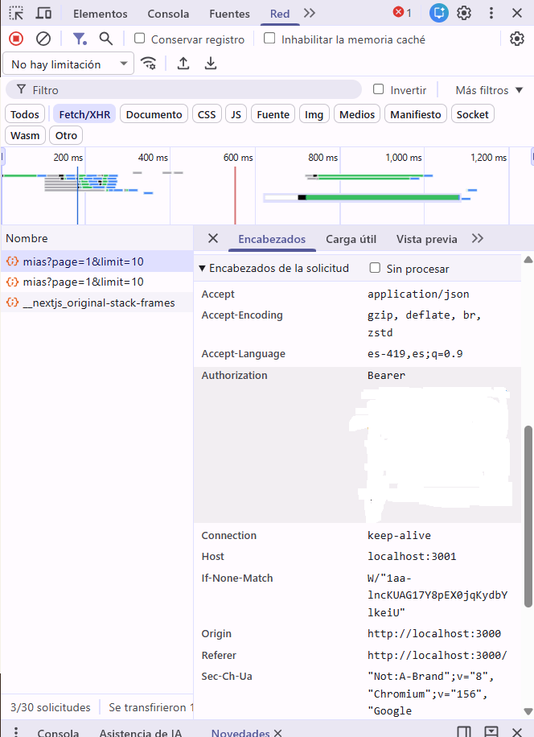

# ChessOnline Shop — Backend

## ¿Qué es el proyecto?

ChessOnline Shop es una tienda en línea de productos de ajedrez: tableros, piezas, relojes y libros. Este repositorio contiene la API REST que proporciona el catálogo, registra usuarios y gestiona pedidos con autenticación y permisos.

El catálogo es público y permite buscar, filtrar y paginar productos. Los usuarios registrados pueden crear pedidos y consultar los propios; los administradores también pueden gestionar el catálogo y consultar todos los pedidos.

## Repositorios y despliegues

- Repositorio del backend: [chess-online-shop-backend](https://github.com/lu1860/chess-online-shop-backend)
- API desplegada: [chess-online-shop-backend.onrender.com](https://chess-online-shop-backend.onrender.com)
- Frontend desplegado:
[chess-online-shop-frontend.vercel.app/](https://chess-online-shop-frontend.vercel.app/) 
- Repositorio del frontend: [chess-online-shop-frontend](https://github.com/lu1860/chess-online-shop-frontend.git)

## Cómo correr el backend en local

### Requisitos

- Node.js `>=20.19`
- npm
- Una base de datos PostgreSQL disponible

### Instalación y configuración

Desde la carpeta del proyecto:

```powershell
npm ci
Copy-Item .env.example .env
```

Edita `.env` y configura las variables requeridas. Luego genera el cliente de Prisma, aplica las migraciones, carga los datos de prueba y arranca el servidor:

```powershell
npm run prisma:generate
npm run prisma:migrate
npm run seed
npm run dev
```

La API local queda disponible en `http://localhost:3001`, salvo que se configure otro puerto.

### Variables de entorno

| Variable | Requerida | Descripción |
| --- | --- | --- |
| `DATABASE_URL` | Sí | Cadena de conexión a PostgreSQL. |
| `JWT_SECRET` | Sí | Secreto largo y aleatorio usado para firmar los tokens|
| `JWT_EXPIRES_IN` | No | Vigencia del token. Por defecto es `2h`; acepta valores como `15m`, `2h`, `1d` o segundos. |
| `PORT` | No | Puerto de la API. Por defecto es `3001`; la plataforma de despliegue puede asignarlo. |
| `FRONTEND_URL` | No | Origen u orígenes permitidos por CORS, separados por comas. Por defecto es `http://localhost:3000`. |

Puedes generar un secreto para desarrollo con:

```powershell
node -e "console.log(require('crypto').randomBytes(48).toString('hex'))"
```

## Credenciales de prueba

Estas cuentas las crea el seed y son solo para la base de datos del ambiente de la entrega. 

| Rol | Correo | Contraseña |
| --- | --- | --- |
| admin | `admin@chessonline.shop` | `Admin2026!` |
| user | `cliente@chessonline.shop` | `Cliente2026!` |

## Decisiones técnicas

- La API está implementada con Express y TypeScript; el código separa las responsabilidades de aplicación, dominio, infraestructura y rutas/controladores.
- PostgreSQL almacena usuarios, productos y pedidos; Prisma gestiona el acceso a la base de datos y las migraciones.
- Las contraseñas se guardan como hashes de bcrypt, no en texto plano.
- El login entrega un JWT Bearer que identifica al usuario y su rol. Las rutas protegidas requieren el header `Authorization: Bearer <token>`.
- Los roles `user` y `admin` controlan las acciones permitidas: por ejemplo, un usuario normal puede consultar sus pedidos, mientras que solo un administrador puede modificar productos o consultar todos los pedidos.
- El catálogo de productos puede consultarse sin iniciar sesión; crear pedidos y acceder a las funciones privadas requiere autenticación.
- Los productos se eliminan de forma lógica para conservar su relación con pedidos existentes.
- CORS permite los orígenes configurados en `FRONTEND_URL`, en lugar de aceptar cualquier origen.

## Autenticación: duración del token y códigos de error

Los access tokens JWT vencen **2 horas** después de iniciar sesión, según el valor predeterminado `JWT_EXPIRES_IN=2h`. No hay renovación automática ni refresh token: cuando vence, el usuario debe iniciar sesión nuevamente. Se puede cambiar la vigencia configurando `JWT_EXPIRES_IN`.

### ¿En qué caso la API responde 401 y en cuál 403? Un ejemplo real


- **401 (no autenticado):** Falta el token, tiene un formato incorrecto, es inválido o venció. También se devuelve si las credenciales de login no son válidas.
- **403 (sin permiso):** El token es válido, pero el rol no tiene permiso para realizar esa acción. Por ejemplo, un usuario `user` que intenta eliminar un producto.

## Uso de IA

Utilicé herramientas de inteligencia artificial como apoyo durante el desarrollo, principalmente para organizar las funcionalidades de la aplicación y pensar cómo distribuir el código y las carpetas del proyecto. También las consulté para identificar qué dependencias necesitaba instalar y para entender mejor el flujo de la aplicación, tomando como referencia el repositorio base proporcionado en clase.

Las sugerencias se contrastaron con el código del repositorio base y con las necesidades de este proyecto antes de aplicarlas. La IA fue una herramienta de consulta y apoyo; revisé las propuestas y decisiones para adaptarlas al funcionamiento de la aplicación.

## Captura de una petición protegida



